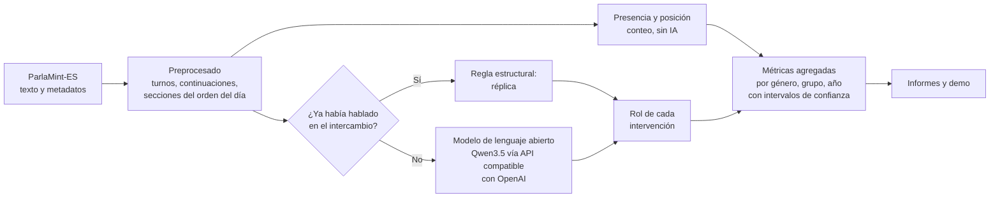

<div align="center">

# Presencia y protagonismo de las mujeres en el Congreso

**Un sistema de IA abierta que mide cuánto hablan las mujeres en los debates parlamentarios y qué papel cumplen cuando hablan.**

_No basta con contar cuántas mujeres intervienen: hay que saber si presentan iniciativas, preguntan al Gobierno o solo fijan la posición de su grupo._

[](https://github.com/may-leth/presencia-parlamentaria/actions/workflows/tests.yml)
[](LICENSE)
[](requirements.txt)
[-teal>)](http://hdl.handle.net/11356/2004)
[-purple>)](THIRD_PARTY.md)
[](#agradecimientos)

</div>

---

## Índice

- [Qué hace](#qué-hace)
- [Resultados principales](#resultados-principales)
- [Cómo funciona](#cómo-funciona)
- [Métricas](#métricas)
- [Fiabilidad del sistema](#fiabilidad-del-sistema)
- [Demo](#demo)
- [Instalación](#instalación)
- [Datos](#datos)
- [Uso](#uso)
- [Perspectiva de género](#perspectiva-de-género)
- [Ética y cumplimiento normativo](#ética-y-cumplimiento-normativo)
- [Puesta en producción](#puesta-en-producción)
- [Hoja de ruta](#hoja-de-ruta)
- [Estructura del repositorio](#estructura-del-repositorio)
- [Contribuir](#contribuir)
- [Componentes de terceros y licencias](#componentes-de-terceros-y-licencias)
- [Cómo citar](#cómo-citar)
- [Licencia](#licencia)
- [Integrantes](#integrantes)
- [Agradecimientos](#agradecimientos)

## Qué hace

Analiza el **texto** de los debates del Pleno del Congreso de los Diputados (2015–2023, corpus [ParlaMint-ES](http://hdl.handle.net/11356/2004)) y calcula, para mujeres y hombres:

- **Presencia:** cuántas personas hablan, cuántas veces y cuántas palabras.
- **Posición en el debate:** quién abre y quién cierra cada sección del orden del día, y en qué momento interviene cada persona.
- **Rol en el debate:** si cada intervención **presenta una iniciativa, pregunta al Gobierno, responde, replica, fija la posición del grupo** o es un trámite. Esta parte la resuelve un **modelo de lenguaje abierto**, porque exige entender el texto.

El sistema no evalúa a personas concretas, no infiere el género (usa el declarado en los datos oficiales) y el modelo de IA nunca recibe nombre, grupo ni género.

## Resultados principales

Sobre las **26.586 intervenciones** de diputadas y diputados del periodo:

|                                                              | Mujeres    | Hombres    |
| ------------------------------------------------------------ | ---------- | ---------- |
| Intervenciones (presencia)                                   | **37 %**   | 63 %       |
| Presenta una iniciativa (sin ministros)                      | **8,4 %**  | 6,5 %      |
| Pregunta al Gobierno (sin ministros)                         | **11,0 %** | 9,0 %      |
| Fija la posición del grupo (sin ministros)                   | 54,5 %     | **57,0 %** |
| Abre una sección del debate (frente a un 36,7 % esperable)   | 39,9 %     | —          |
| Cierra una sección del debate (frente a un 36,7 % esperable) | 43,5 %     | —          |
| Intervenciones de miembros del Gobierno                      | **54,9 %** | 45,1 %     |

> **La brecha principal está en cuánto intervienen las mujeres, no en qué papel cumplen.** Cuando intervienen, las diputadas presentan algo más de iniciativas y preguntan más al Gobierno, y abren y cierran los debates al menos en proporción a su presencia. Las ministras cumplen los mismos papeles que los ministros.

Son diferencias pequeñas pero consistentes, con intervalos de confianza que no se solapan. Más tiempo de palabra no implica más influencia, y los datos no dicen _por qué_ ocurren. Detalle y cautelas en [docs/01-metricas.md](docs/01-metricas.md).

<p align="center"></p>

## Cómo funciona



**Método híbrido para el rol:**

1. **Regla estructural:** si la persona ya había hablado en ese intercambio (se ve en la secuencia anónima de turnos, por ejemplo `P A P B P → A`), su turno es una **réplica**. Es determinista, explicable y gratuita, y resuelve el 27 % de las intervenciones.
2. **Modelo de lenguaje abierto** para el resto: lee el anuncio de la presidencia, la secuencia de turnos y el inicio del discurso, y elige el rol con la ayuda de **15 ejemplos anotados a mano** (aprendizaje en contexto). No recibe nombre, grupo ni género.

El cliente usa una **API compatible con OpenAI**: el modelo se cambia con un parámetro (`--modelo`) y el proveedor con una variable de entorno, sin tocar código. Se compararon tres modelos abiertos (Qwen3.5-397B-A17B, gpt-oss-120b y Qwen3.5-9B) y se eligió por evaluación.

Presencia, apertura, cierre y posición salen de contar metadatos. La IA se usa solo para el rol, donde unas reglas de palabras clave no detectaban ninguna defensa de iniciativas y se equivocaban más del doble con las mujeres.

## Métricas

| Id         | Métrica                                                                    | Método                  | Alcance                                        |
| ---------- | -------------------------------------------------------------------------- | ----------------------- | ---------------------------------------------- |
| P1–P4      | % de oradoras, de intervenciones y de palabras; intervenciones por persona | Conteo                  | Todo el corpus                                 |
| R1, R2     | Apertura y cierre de cada sección del orden del día                        | Conteo (XML TEI)        | Todo el corpus                                 |
| R4         | Intervenciones largas                                                      | Conteo                  | Todo el corpus                                 |
| R5         | Posición media en el debate, también dentro de cada grupo parlamentario    | Conteo                  | Todo el corpus                                 |
| R7         | Rol en el debate                                                           | **IA (método híbrido)** | 26.586 intervenciones de diputadas y diputados |
| R3, R6, T1 | Moderación (excluida y justificada), reacciones y temas (exploratorias)    | Reglas y metadatos      | Todo el corpus                                 |

Definiciones, resultados y limitaciones: [docs/01-metricas.md](docs/01-metricas.md).

## Fiabilidad del sistema

Evaluado contra **intervenciones anotadas a mano y a ciegas** (sin ver nombre, grupo ni género):

| Prueba                                     | Resultado                                                                                                |
| ------------------------------------------ | -------------------------------------------------------------------------------------------------------- |
| Conjunto de evaluación (102 filas)         | Híbrido: accuracy **0,922**, F1 macro **0,888**; reglas sin IA: 0,873 / 0,683                            |
| Confirmación en filas nuevas (30)          | Híbrido: accuracy **0,867**, F1 macro 0,694                                                              |
| Acuerdo entre dos anotadoras (34 filas)    | 76,5 %, kappa de Cohen **0,675** (sustancial)                                                            |
| Sistema frente a cada anotadora (34 filas) | 85,3 % y 79,4 %: al nivel del acuerdo humano                                                             |
| **Error por género**                       | Reglas: 9 errores con mujeres y 4 con hombres. Híbrido: 5 y 3; en la confirmación, 2 y 2                 |
| Validación del muestreo                    | Las estimaciones de una muestra estratificada de 3.000 contenían el valor real del corpus en los 7 roles |

Muestras pequeñas: las cifras de calidad son orientativas. Detalle en [docs/05-evaluacion.md](docs/05-evaluacion.md) y [docs/06-acuerdo-y-confirmacion.md](docs/06-acuerdo-y-confirmacion.md).

## Demo

Una interfaz con [Gradio](https://www.gradio.app/) con tres pantallas:

1. **¿Quién protagoniza el debate?** Rol y posición por género, con intervalos de confianza y filtro por grupo.
2. **Así decide el sistema.** Intervenciones reales con la secuencia de turnos, el rol asignado, **si lo decidió la regla o el modelo** y la etiqueta humana. Los nombres se ocultan.
3. **¿El sistema es justo?** Acierto con intervenciones de mujeres y de hombres, reglas frente a híbrido.

Funciona **sin conexión con el modelo**: usa resultados ya calculados y la caché.

```bash
python app.py                  # http://localhost:7860
python app.py --compartir      # además, un enlace público temporal de Gradio
```

## Instalación

Requisitos: Python 3.11 o superior.

```bash
git clone https://github.com/may-leth/presencia-parlamentaria.git
cd presencia-parlamentaria
python -m venv .venv
source .venv/bin/activate        # En Windows: .venv\Scripts\activate
pip install -r requirements.txt
python -m pytest -q              # comprobación
```

Para llamar al modelo (solo hace falta para clasificar intervenciones nuevas), crea un archivo `.env` en la raíz, que Git ignora:

```
AI_TOKEN=tu_token
# Opcionales: AI_BASE_URL (proveedor compatible con OpenAI), AI_MODEL, AI_TIMEOUT
```

## Datos

Los datos **no se incluyen** en el repositorio: se descargan de su fuente oficial (CLARIN.SI) y se verifican con MD5. Instrucciones: [data/README.md](data/README.md). Descripción y límites del corpus: [docs/02-datos.md](docs/02-datos.md).

El repositorio sí incluye lo necesario para reproducir los resultados sin repetir el trabajo manual ni las llamadas al modelo: los identificadores y etiquetas de la anotación (`data/annotated/`), la caché de respuestas del modelo (`data/processed/llm/`) y los resúmenes agregados (`data/processed/*_resumen*.csv`).

## Uso

Desde la raíz del repositorio, con los datos en `data/raw/`:

```bash
# Exploración y presencia
python src/presencia/explore.py data/raw/ParlaMint-ES.txt --salida data/processed/informe.txt

# Evaluación del clasificador contra la anotación humana (usa la caché)
python src/presencia/evaluate.py data/annotated/muestra_anotada.csv --modelo Qwen3.5-397B-A17B --hibrido --errores

# Acuerdo entre anotadoras (con las etiquetas publicadas)
python src/presencia/agreement.py data/annotated/anotadora2_etiquetas.csv --solo-kappa

# Rol de todas las intervenciones (reanudable; con la caché no repite llamadas)
python src/presencia/classify.py data/raw/ParlaMint-ES.txt --n 0 --estimar
python src/presencia/classify.py data/raw/ParlaMint-ES.txt --n 0 --paralelo 4 --salida data/processed/roles_completo.csv

# Métricas de rol por género
python src/presencia/roles.py data/processed/roles_completo.csv --salida data/processed/roles_resumen_completo.csv

# Apertura, cierre y posición en el debate
python src/presencia/posicion.py data/raw/ParlaMint-ES.txt

# Gráficos y demo
python src/presencia/figures.py
python app.py
```

## Perspectiva de género

La perspectiva de género se aplica a la pregunta **y al propio sistema**:

- **Se mide el error por género del clasificador**, no solo su acierto global. Un sistema sin IA habría infravalorado el protagonismo de las mujeres, porque los roles que peor detectan las reglas (presentar iniciativas, preguntar) son roles de protagonismo.
- **Muestreo con igual número de mujeres y hombres** para medir a ambos grupos con la misma precisión.
- **Anotación a ciegas**: se usa el género declarado en los metadatos oficiales.
- **Lectura sin estereotipos:** los resultados se controlan por grupo parlamentario, tipo de debate y cargo, para no atribuir al género lo que se debe al reglamento o a la organización de los grupos.
- **Limitación declarada:** los metadatos solo recogen género binario.

## Ética y cumplimiento normativo

- **Datos personales:** intervenciones públicas de cargos públicos, pero con datos personales y de categoría especial (el grupo parlamentario revela opiniones políticas). Solo resultados agregados, minimización y privacidad por diseño.
- **Reglamento europeo de IA:** según nuestro análisis, no es un sistema de alto riesgo; se aplican transparencia y alfabetización en IA.
- **Directrices europeas para una IA fiable (ALTAI):** correspondencia con los siete requisitos.
- **Licencias abiertas** de código, datos y modelos.

Análisis completo, riesgos y mitigaciones: [docs/03-etica.md](docs/03-etica.md). No es asesoramiento jurídico.

## Puesta en producción

Caso de uso: un **observatorio de la presencia y el protagonismo de las mujeres en el Congreso**, con informes periódicos y agregados para unidades de igualdad, observatorios, periodismo de datos e investigación.

- Ejecución por lotes, en contenedor, en la UE, con modelo intercambiable (servicio gestionado o autoalojado).
- Vigilancia periódica de la calidad y del **error por género**, con umbrales de alerta y revisión humana antes de publicar.
- Permisos y acuerdos: licencia de los datos, reutilización de información del sector público, protección de datos, encargo del tratamiento con el proveedor de IA y acuerdo de uso con la institución usuaria.
- Probado en condiciones reales: la clasificación del corpus completo superó una parada automática del entorno y una caída del servicio de IA gracias a la caché y los reintentos.

Plan completo: [docs/07-despliegue.md](docs/07-despliegue.md).

## Hoja de ruta

El reto se organizó en tres fases: proponer métricas, construir un sistema que las extraiga del texto y definir su puesta en producción. Las tres están completas. Lo siguiente sigue las fases del [plan de despliegue](docs/07-despliegue.md): piloto, validación con usuarias reales y producción.

### Fase 1 · Métricas de presencia y protagonismo ✅

- [x] Explorar ParlaMint-ES 5.0 y documentar sus límites: presidencia sin identificar en la mayoría de los turnos, columna `Agenda` vacía, datos hasta febrero de 2023 y género binario
- [x] Presencia (P1–P4): oradoras, intervenciones, palabras e intervenciones por persona
- [x] Protagonismo: apertura (R1) y cierre (R2) por sección del orden del día, intervenciones largas (R4), posición en el debate (R5) y rol de cada intervención (R7)
- [x] Excluir la moderación (R3) de forma justificada, para no inferir el género de la presidencia
- [x] Reacciones del hemiciclo (R6) y temas (T1), de forma exploratoria

### Fase 2 · Sistema inteligente sobre texto ✅

- [x] Preprocesado del corpus: turnos, continuaciones y secciones del orden del día a partir del XML TEI
- [x] Anotación a ciegas con guía, segunda anotadora y conjunto de confirmación
- [x] Línea base por reglas y cliente agnóstico respecto al modelo (API compatible con OpenAI)
- [x] Comparación de tres modelos abiertos y método híbrido (regla estructural + LLM)
- [x] Evaluación con accuracy, F1 por clase, matriz de confusión y **error por género** del propio sistema
- [x] Clasificación de las 26.586 intervenciones de diputadas y diputados, con caché, reanudación y reintentos
- [x] Demo con Gradio que funciona sin conexión con el modelo

### Fase 3 · Plan de puesta en producción ✅

- [x] Caso de uso, arquitectura, operación, costes y riesgos ([docs/07-despliegue.md](docs/07-despliegue.md))
- [x] Permisos y acuerdos, RGPD, Reglamento de IA y ALTAI ([docs/03-etica.md](docs/03-etica.md))
- [x] Repositorio reproducible: tests, integración continua, licencias y guía de contribución

### Piloto (1–3 meses tras el reto)

- [ ] **Guía de anotación v3:** aclarar la frontera entre presentar una iniciativa o enmienda (`defensa`) y fijar posición sobre ella (`posicion`), y el caso del primer turno breve de quien pregunta; anotar a ciegas los casos dudosos y repetir la evaluación
- [ ] **Más anotación humana:** ampliar la doble anotación para estrechar los intervalos de calidad, que hoy salen de muestras pequeñas
- [ ] **Error de la métrica agregada:** comparar el reparto de roles por género que da el sistema con el de la anotación humana, además del acierto por intervención
- [ ] **Validar R6 y T1:** limpiar la clasificación de las reacciones y comprobar cómo asigna ParlaMint el campo `Topic` antes de sacar conclusiones
- [ ] **Modelo local:** evaluar un modelo abierto pequeño en GPU propia como alternativa al servicio gestionado, para reducir la dependencia del proveedor

### Validación (3–6 meses)

- [ ] **Usuaria real:** probar los informes con una unidad de igualdad, un observatorio o un medio de periodismo de datos, y ajustar el panel a sus preguntas
- [ ] **Acuerdos formales:** encargo del tratamiento con el proveedor de IA, evaluación de impacto en protección de datos y acuerdo de uso con la institución usuaria
- [ ] **Nuevas métricas de protagonismo:** menciones (a quién se nombra y cómo se le trata) e interrupciones entre oradores, cada una con su muestra anotada y su comparación entre reglas e IA

### Producción (6–12 meses)

- [ ] **Datos posteriores a 2023:** adaptador para los datos abiertos del Congreso de los Diputados, con las condiciones de reutilización de información del sector público
- [ ] **Informe periódico** por legislatura, grupo y rol, con revisión humana antes de publicar
- [ ] **Vigilancia continua:** muestra anotada en cada actualización para controlar accuracy, F1 y error por género, con umbral de alerta
- [ ] **Otras fuentes mediante adaptadores:** empezar por los parlamentos autonómicos de ParlaMint, con prompt y evaluación propios para cada lengua

### Fuera de alcance

- Rankings o valoraciones de personas concretas: solo se publican resultados agregados.
- Inferir el género a partir del nombre, la voz o el texto: solo se usa el género declarado.
- Interpretar el tiempo de palabra o la posición en el debate como influencia política.

¿Quieres ayudar con alguno de estos puntos? Mira [Contribuir](#contribuir).

## Estructura del repositorio

```
├── app.py                     Demo con Gradio
├── data/
│   ├── README.md              Descarga y verificación de los datos
│   ├── annotated/             Anotación humana (identificadores y etiquetas)
│   └── processed/             Resultados agregados y caché del modelo
├── docs/
│   ├── 01-metricas.md         Métricas, resultados y limitaciones
│   ├── 02-datos.md            El corpus y sus límites
│   ├── 03-etica.md            Ética, perspectiva de género y cumplimiento
│   ├── 04-guia-anotacion.md   Guía de anotación
│   ├── 05-evaluacion.md       Evaluación del clasificador y resultados
│   ├── 06-acuerdo-y-confirmacion.md
│   ├── 07-despliegue.md       Plan de puesta en producción
│   └── figuras/               Gráficos
├── src/presencia/             Código fuente
├── tests/                     Pruebas (pytest)
├── CONTRIBUTING.md · CODE_OF_CONDUCT.md · SECURITY.md · CITATION.cff
├── LICENSE · THIRD_PARTY.md · requirements.txt
```

## Contribuir

Las contribuciones son bienvenidas: nuevas métricas (interrupciones, menciones), otros parlamentos de ParlaMint, más anotación humana o mejoras del clasificador. La [hoja de ruta](#hoja-de-ruta) recoge las prioridades. Lee [CONTRIBUTING.md](CONTRIBUTING.md) y el [código de conducta](CODE_OF_CONDUCT.md). Para avisar de un problema de seguridad o de datos personales, sigue [SECURITY.md](SECURITY.md).

## Componentes de terceros y licencias

| Componente                                       | Uso                                          | Licencia                             |
| ------------------------------------------------ | -------------------------------------------- | ------------------------------------ |
| ParlaMint-ES 5.0 (CLARIN.SI)                     | Datos                                        | CC BY 4.0                            |
| Qwen3.5-397B-A17B                                | Modelo principal (vía OVHcloud AI Endpoints) | Apache 2.0                           |
| gpt-oss-120b, Qwen3.5-9B                         | Modelos evaluados                            | Apache 2.0                           |
| Gradio, matplotlib, pandas, lxml, openai, pytest | Dependencias de Python                       | Ver [THIRD_PARTY.md](THIRD_PARTY.md) |

## Cómo citar

Usa el botón **«Cite this repository»** de GitHub (archivo [CITATION.cff](CITATION.cff)). Si usas los datos, cita también ParlaMint: <http://hdl.handle.net/11356/2004>.

## Licencia

Código bajo licencia **MIT** ([LICENSE](LICENSE)). Los datos y los modelos tienen sus propias licencias (ver [THIRD_PARTY.md](THIRD_PARTY.md)).

## Integrantes

<table>
  <tr>
    <td align="center">
      <a href="https://github.com/may-leth">
        
        <br />
        <sub><b>Mayleth Carrascal Molina</b></sub>
      </a>
      <br />
      <sub>Backend Developer</sub>
    </td>
    <td align="center">
      <a href="https://github.com/acpp2510">
        
        <br />
        <sub><b>Ana Carina Pillajo</b></sub>
      </a>
      <br />
      <sub>Backend Developer</sub>
    </td>
    <td align="center">
      <a href="https://github.com/morenaperalta">
        
        <br />
        <sub><b>Morena Peralta Almada</b></sub>
      </a>
      <br />
      <sub>Backend Developer</sub>
    </td>
  </tr>
</table>

## Agradecimientos

Proyecto del equipo **MeduSSia** para el reto **«Mujeres por la IA Abierta»** (Secretaría de Estado de Digitalización e Inteligencia Artificial, Comunidad IA de Código Abierto). Gracias a **OVHcloud** por el entorno de cómputo y los AI Endpoints, y al consorcio **ParlaMint** y **CLARIN.SI** por publicar el corpus en abierto.
