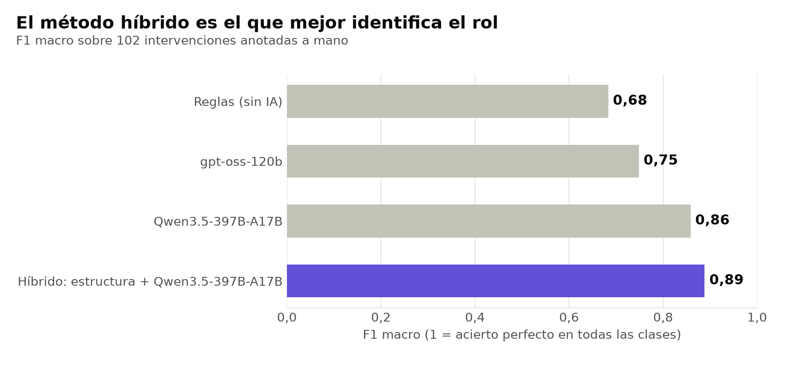
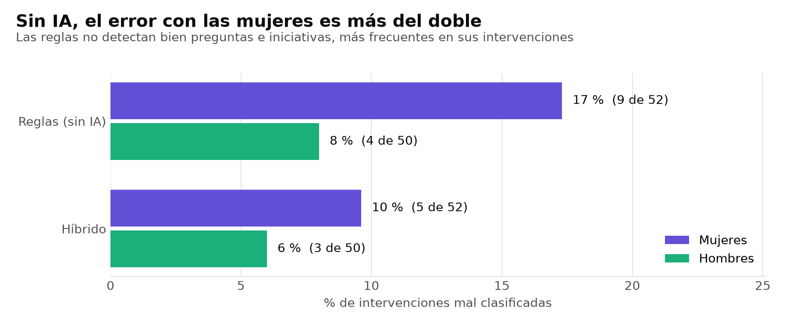
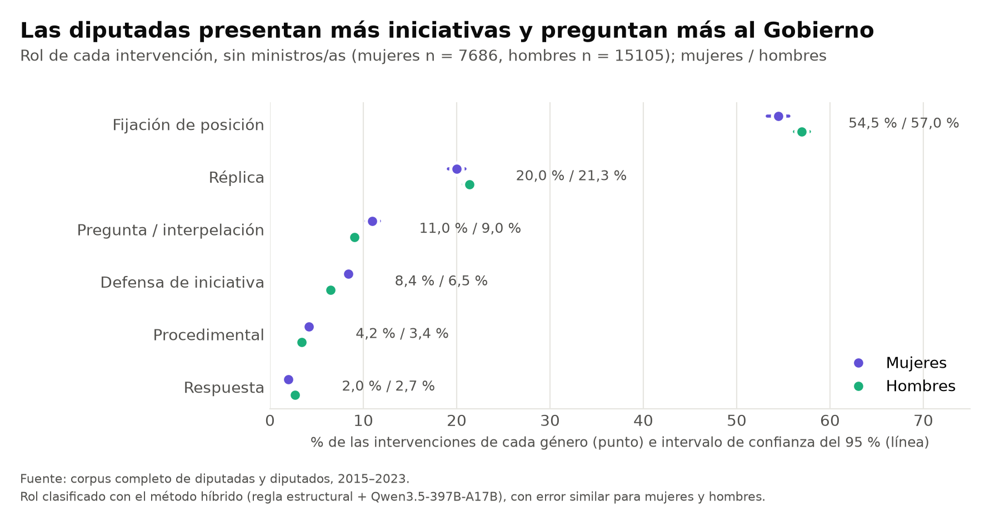

# Evaluación del clasificador de roles

> **Estado:** 28/10/2026. Evaluación sobre `data/annotated/muestra_anotada.csv`; acuerdo entre anotadoras y confirmación en filas nuevas en `06-acuerdo-y-confirmacion.md`; aplicación a **todo el corpus** de diputadas y diputados (26.586 intervenciones) y validación del diseño muestral con la muestra previa de 3.000.

Gráficos (se regeneran con `python src/presencia/figures.py`): `docs/figuras/`.

## Montaje

- **Tarea:** asignar a cada intervención su función en el debate: `defensa`, `pregunta`, `respuesta`, `replica`, `posicion`, `procedimental` u `otra` (guía: `04-guia-anotacion.md`).
- **Muestra:** 120 intervenciones (60 de mujeres y 60 de hombres, al azar, semilla 42), anotadas **a ciegas** (sin género, nombre ni grupo). Las 15 primeras son de **calibración** (ejemplos para el modelo) y no se evalúan. Quedan **102 de evaluación**.
- **Entrada de todos los métodos:** la misma que vio la anotadora: turno anterior de la presidencia, otro turno previo, `secuencia` de turnos anonimizada, inicio y final del texto, y número de palabras.
- **Modelos:** abiertos, servidos en OVHcloud AI Endpoints mediante la API compatible con OpenAI, con `temperature = 0` y 15 ejemplos (*few-shot*).
- **Métrica principal:** F1 macro, que da el mismo peso a las clases pequeñas (`defensa` tiene 4 casos y `pregunta` tiene 9).

## Resultados

| Método | Accuracy | F1 macro |
|---|---|---|
| Reglas (*baseline*, sin IA) | 0,873 | 0,683 |
| gpt-oss-120b | 0,873 | 0,748 |
| Qwen3.5-397B-A17B | 0,892 | 0,858 |
| **Híbrido: estructura + Qwen3.5-397B-A17B** | **0,922** | **0,888** |
| Qwen3.5-9B | no completado | — |



- Las reglas aciertan las réplicas, porque la `secuencia` muestra si la persona ya había hablado. Fallan en lo que exige leer el texto: no detectan ninguna `defensa` y confunden preguntas y respuestas con fijaciones de posición.
- Qwen3.5-397B acierta todas las `pregunta`, `respuesta`, `defensa` y `procedimental`, pero tiende a ver demasiadas: 5 réplicas las etiqueta como `respuesta` y 5 posiciones como `defensa`.
- **El método híbrido** combina lo mejor de cada uno. La réplica se decide por la estructura de turnos (regla determinista y explicable) y el resto lo decide el modelo. Además, ahorra alrededor del 30 % de las llamadas al modelo.
- Qwen3.5-9B se descartó en modo razonamiento: 33 filas en una noche, con *timeouts*, en el endpoint gratuito. Queda pendiente una prueba sin razonamiento (`--sin-razonamiento`).

Para reproducirlo (usa la caché de `data/processed/llm/`, sin llamadas nuevas):

```
python src/presencia/evaluate.py data/annotated/muestra_anotada.csv --modelo Qwen3.5-397B-A17B --modelo gpt-oss-120b --hibrido --errores
```

## Error por género

El género no se mostró al anotar ni se envía al modelo. Se une después por el ID desde `data/processed/intervenciones.csv`.

| Método | Mujeres (n = 52) | Hombres (n = 50) |
|---|---|---|
| Reglas | 9 errores (acc. 0,83) | 4 errores (acc. 0,92) |
| Qwen3.5-397B-A17B | 6 errores (acc. 0,88) | 5 errores (acc. 0,90) |
| Híbrido | 5 errores (acc. 0,90) | 3 errores (acc. 0,94) |



**Las reglas se equivocan más del doble con las intervenciones de mujeres.** El motivo es que en la muestra hay más preguntas e iniciativas de mujeres (7 preguntas frente a 2) y las reglas no detectan bien esos roles, que son justo los de protagonismo. Un sistema solo de reglas habría **infravalorado el protagonismo de las mujeres**. El modelo reduce esa brecha de error, aunque no la elimina del todo. Con 50 filas por género la diferencia es orientativa, y debe vigilarse en la confirmación con filas nuevas.

## Cautelas

- **Muestra pequeña.** Con 102 filas y clases de 4 a 9 casos, una fila cambia el F1 de una clase en más de 0,1. La ventaja sobre las reglas es clara. La diferencia entre modelos es indicativa.
- **El híbrido se eligió después de ver los errores** en este mismo conjunto. La regla de réplica ya existía en el *baseline* y no se ajustó, pero para confirmarlo sin sesgo hay que evaluarlo en filas nuevas (ver abajo).
- **Segunda anotadora (resuelto).** Una segunda persona anotó a ciegas 64 intervenciones: kappa de Cohen 0,675 en 34 filas comunes (acuerdo sustancial) y confirmación en 30 filas nuevas (accuracy 0,867, F1 macro 0,694, 2 errores con mujeres y 2 con hombres). Ver `06-acuerdo-y-confirmacion.md`.
- **Igualdad de error por género.** El error total es parecido (5 de 52 frente a 3 de 50) y en la confirmación es igual (2 y 2). La única clase dudosa era `defensa`: ver la sección siguiente.

## La duda de `defensa`

Hay 5 intervenciones en las que el modelo dice `defensa` y la anotación dice `posicion`, y 4 de ellas son de mujeres. En las 52 filas de mujeres, la anotación tiene 3 defensas y el modelo pone 7. Al revisar los casos, varios cumplen la definición de la guía («abre un punto presentando una iniciativa»). En uno, por ejemplo, la presidencia anuncia «Para la presentación de la iniciativa tiene la palabra la señora…» y la oradora empieza «presentamos a la consideración de la Cámara una iniciativa». En otros se defienden enmiendas, y la guía menciona las enmiendas dentro de `defensa` pero también dice «turno de un grupo en un debate: `posicion`».

Por tanto, no se sabía si el error era del modelo o de la anotación. Siguiendo la guía, las etiquetas humanas no se cambian para que coincidan con el modelo.

**Resolución (27/10).** La segunda anotadora etiquetó a ciegas los 5 casos, mezclados con otras filas: en **3 coincide con el modelo** (`defensa`) y en 2 con la primera anotación (`posicion`). Los 3 casos ambiguos son de mujeres; los 2 errores confirmados del modelo son uno de una mujer y uno de un hombre. Conclusión: **la diferencia en `defensa` entre mujeres y hombres no es un artefacto del modelo**; la frontera entre presentar enmiendas (`defensa`) y fijar posición sobre ellas (`posicion`) se aclara en la propuesta de guía v3. Detalle en `06-acuerdo-y-confirmacion.md`.

## Aplicación al corpus: rol por género

### Corpus completo (resultado principal)

El método híbrido se aplicó con Qwen3.5-397B-A17B a **todas las intervenciones de diputadas y diputados**: 26.586 (rol `Regular`, género F o M, sin continuaciones ni las 120 filas anotadas a mano; 9.770 de mujeres y 16.816 de hombres). Se resolvieron **7.051 por estructura** (réplica) y **19.535 con el modelo**, sin ninguna fila sin respuesta. Se ejecutó en el entorno JupyterLab de OVHcloud contra OVHcloud AI Endpoints, en segundo plano, con caché, reanudación y reintentos automáticos: superó una parada automática del entorno y una caída temporal del servicio de IA. La caché del modelo está en el repositorio, así que el resultado se reproduce sin nuevas llamadas.

```bash
python src/presencia/classify.py data/raw/ParlaMint-ES.txt --n 0 --paralelo 4 --salida data/processed/roles_completo.csv
python src/presencia/roles.py data/processed/roles_completo.csv --salida data/processed/roles_resumen_completo.csv
```



Diputadas y diputados, sin ministros/as (mujeres n = 7.686, hombres n = 15.105). Intervalos de Wilson del 95 %:

| Rol | Mujeres | Hombres | Razón |
|---|---|---|---|
| Fijación de posición | 54,5 % [53,3–55,6] | **57,0 %** [56,2–57,8] | 0,97 |
| Réplica | 20,0 % [19,1–20,9] | 21,3 % [20,7–22,0] | 0,96 |
| Pregunta / interpelación | **11,0 %** [10,3–11,7] | 9,0 % [8,6–9,5] | 1,13 |
| Defensa de iniciativa | **8,4 %** [7,8–9,0] | 6,5 % [6,1–6,9] | 1,17 |
| Procedimental | 4,2 % [3,8–4,6] | 3,4 % [3,1–3,7] | 1,15 |
| Respuesta | 2,0 % [1,7–2,3] | 2,7 % [2,5–3,0] | 0,80 |

**Lectura:** las mujeres hacen el 37 % de las intervenciones (presencia, P2), pero **cuando intervienen ocupan algo más los papeles de protagonismo**: presentan más iniciativas y preguntan más al Gobierno; los hombres, en proporción, fijan más la posición de su grupo. El patrón se repite en la oposición (defensa 8,4 % frente a 6,7 %; pregunta 12,7 % frente a 10,8 %) y en el Gobierno y sus socios (defensa 8,3 % frente a 5,9 %). Las **ministras** hacen el 54,9 % de las intervenciones del Gobierno y cumplen los mismos papeles que los ministros (respuesta 31,0 % frente a 30,1 %; réplica 61,8 % frente a 63,5 %).

**Cómo leer las cifras:** proceden de un clasificador (accuracy 0,867 en filas nuevas), no de una anotación humana. Al cubrir todo el corpus no hay error de muestreo, pero sí error de clasificación; las diferencias son pequeñas (unos 2 puntos) y se consideran consistentes porque el error del clasificador es similar para mujeres y hombres y la duda de `defensa` se resolvió a favor del modelo. El total «todas» mezcla ministros/as y diputados/as: sus diferencias se deben a la composición del Gobierno, no al rol, así que hay que usar los grupos separados.

### Muestra estratificada previa y validación del diseño muestral

Antes de clasificar el corpus completo, el método se aplicó a **3.000 intervenciones** (1.500 de mujeres y 1.500 de hombres al azar, semilla 2026), con pesos para estimar el corpus (`data/processed/roles_resumen.csv`). Las estimaciones de esa muestra **contenían el valor real del corpus completo en los 7 roles**:

| Rol (sin ministros) | Muestra: mujeres [IC 95 %] | Corpus completo: mujeres | Muestra: hombres | Corpus completo: hombres |
|---|---|---|---|---|
| Defensa | 8,7 % [7,2–10,5] | 8,4 % | 5,9 % | 6,5 % |
| Pregunta | 10,6 % [9,0–12,5] | 11,0 % | 8,9 % | 9,0 % |
| Respuesta | 2,0 % [1,4–3,0] | 2,0 % | 2,3 % | 2,7 % |
| Réplica | 20,8 % [18,6–23,2] | 20,0 % | 22,4 % | 21,3 % |
| Posición | 54,2 % [51,3–57,0] | 54,5 % | 57,4 % | 57,0 % |
| Procedimental | 3,6 % [2,7–4,9] | 4,2 % | 3,0 % | 3,4 % |

El muestreo estratificado con asignación igual por género y pesos es, por tanto, una alternativa válida y unas 9 veces más barata (unas 2.200 llamadas al modelo frente a 19.535) para actualizaciones periódicas. Con la muestra, la única diferencia significativa era `defensa`; con el corpus completo, los intervalos se estrechan y también lo es `pregunta`.
