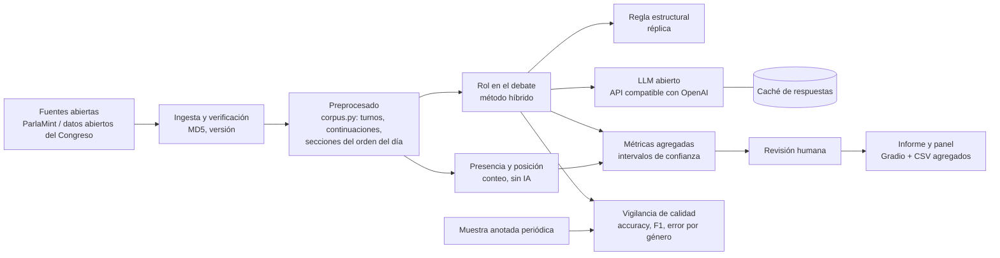

# Plan de puesta en producción

> **Estado:** borrador del 27/10/2026. Describe cómo pasar del prototipo actual (ParlaMint-ES 2015–2023) a un servicio que funcione de forma continua, ética y legal.

## 1. Caso de uso

**Observatorio de la presencia y el protagonismo de las mujeres en el Congreso.** Un informe periódico (por legislatura y por año) que responde a tres preguntas:

1. **Presencia:** ¿cuánto hablan las mujeres? (personas, intervenciones, palabras)
2. **Rol:** cuando hablan, ¿qué papel cumplen? (presentar iniciativas, preguntar al Gobierno, responder, replicar, fijar posición)
3. **Posición:** ¿abren y cierran los debates, o quedan en medio?

Todo en **agregado** (por grupo, tipo de sección, año, cargo), con intervalos de confianza y con la fiabilidad del propio sistema, incluido su error por género.

| Usuarias previstas | Para qué |
|---|---|
| Unidades de igualdad de instituciones públicas y parlamentos | Diagnóstico y seguimiento de planes de igualdad |
| Observatorios e institutos de igualdad | Indicadores periódicos comparables |
| Periodismo de datos | Información verificable sobre representación |
| Investigación académica | Datos y método reutilizables y reproducibles |
| Grupos parlamentarios | Revisar cómo reparten internamente los turnos de palabra |

**Fuera del uso previsto:** evaluar, puntuar o señalar a personas concretas, o usar los resultados para orientar campañas electorales o el voto. Ver `03-etica.md`.

## 2. Arquitectura

- **Ejecución por lotes**, no en tiempo real: cuando se publican nuevas sesiones (por ejemplo, cada mes o al cerrar un periodo de sesiones).
- **Contenedor** con las dependencias de `requirements.txt` y versiones fijadas, para que el resultado no cambie según la máquina.
- **Modelo intercambiable:** el cliente usa una API compatible con OpenAI, así que el modelo se cambia con un parámetro (`--modelo`) o con la URL del servicio (`OVH_AI_BASE_URL`), sin tocar código. Dos opciones:
  - **Servicio gestionado en la UE** (OVHcloud AI Endpoints): sin infraestructura propia, con límites de peticiones y dependencia del proveedor.
  - **Modelo autoalojado:** un modelo abierto más pequeño servido en GPU propias con una API compatible con OpenAI. Más control y soberanía; requiere evaluarlo antes con la muestra anotada.
- **Reanudable:** cada respuesta del modelo se guarda en caché, así que una caída o un reinicio no obliga a empezar de nuevo. Se ha probado en la práctica con una parada automática del entorno y con una caída del proveedor.

## 3. Fases

| Fase | Qué se hace | Criterio para avanzar |
|---|---|---|
| **0. Prototipo (hecho)** | ParlaMint-ES 2015–feb. 2023; evaluación con muestra anotada, kappa y confirmación; métricas de presencia, posición y rol | Híbrido mejor que las reglas, sin brecha de error por género en la confirmación |
| **1. Validación con una usuaria real** (1–2 meses) | Presentar el informe a una unidad u observatorio de igualdad; guía de anotación v3; ampliar la muestra de confirmación; resolver dudas como `defensa` frente a `posicion` | La usuaria considera útiles los indicadores; kappa ≥ 0,7 con la guía nueva |
| **2. Datos actuales** (2–3 meses) | Adaptador para los datos abiertos del Congreso posteriores a 2023; identificar el punto del orden del día por iniciativa y no solo por sección | Mismo formato de entrada que ParlaMint; evaluación repetida con datos nuevos |
| **3. Producción** | Ejecución periódica, panel público de resultados agregados, vigilancia de calidad | Ver sección 5 |
| **4. Escalado** | Otros parlamentos con el mismo formato (ParlaMint cubre una treintena de parlamentos europeos) y otras fuentes de texto mediante adaptadores (por ejemplo, prensa) | Evaluación con muestra anotada en cada nueva fuente o idioma |

## 4. Permisos y acuerdos necesarios

| Ámbito | Qué hace falta |
|---|---|
| **Datos de ParlaMint** | Licencia CC BY 4.0: atribución en el informe, el panel y el repositorio |
| **Datos nuevos del Congreso** | Comprobar las condiciones de reutilización de los datos abiertos del Congreso y de la normativa de reutilización de la información del sector público; atribución |
| **Protección de datos** | Identificar a la entidad responsable del tratamiento y su base jurídica; registro de actividades de tratamiento; evaluación de impacto recomendada; información pública sobre el tratamiento y canal para ejercer derechos (ver `03-etica.md`) |
| **Proveedor de IA en la nube** | Contrato de encargo del tratamiento; tratamiento en la UE; condiciones de uso y límites de peticiones del servicio |
| **Modelo de lenguaje** | Licencia abierta compatible (Apache 2.0 para Qwen3.5 y gpt-oss); revisarla en cada cambio de modelo |
| **Reglamento de IA** | Clasificación como no alto riesgo documentada; transparencia en los informes (qué parte la hace la IA y con qué precisión); alfabetización en IA de quien lo use |
| **Institución usuaria** | Acuerdo sobre el uso previsto (solo agregados, nada de evaluar a personas) y sobre quién revisa los resultados antes de publicarlos |

## 5. Operación y vigilancia

| Qué se vigila | Cómo | Umbral de alerta |
|---|---|---|
| Calidad del clasificador | Cada periodo, una persona anota a ciegas una muestra nueva (unas 50 intervenciones) y se compara con el sistema | F1 macro por debajo de 0,65 o caída de más de 0,1 |
| **Equidad del clasificador** | Error con intervenciones de mujeres frente a hombres en esa misma muestra | Diferencia de accuracy por género mayor de 5 puntos |
| Acuerdo entre personas | Una parte de la muestra la anotan dos personas | Kappa por debajo de 0,6: revisar la guía |
| Respuestas sin etiqueta | Filas `sin_respuesta` (timeouts del proveedor) | Más del 1 %: relanzar antes de publicar |
| Cambios de modelo o de prompt | Versionado en el repositorio; cada cambio exige repetir la evaluación | — |
| Proveedor | Disponibilidad de la API; reintentos automáticos; alternativa autoalojada | Caída de más de 24 horas: pasar al modelo alternativo |

**Revisión humana:** ningún informe se publica sin que una persona revise los resultados, sus cautelas y los casos dudosos.

## 6. Coste y uso de recursos

- **Reglas cuando bastan:** presencia, apertura, cierre y posición no usan IA.
- **Método híbrido:** las réplicas se deciden por la estructura de turnos, sin llamar al modelo. En el corpus completo de diputadas y diputados son 7.051 de 26.586 intervenciones, alrededor de un 27 % menos de llamadas.
- **Corpus completo frente a muestra:** clasificar las 26.586 intervenciones requiere unas 19.500 llamadas al modelo (entre 20 y 30 horas de proceso con el servicio gratuito y sus límites). Una muestra estratificada de 3.000, con pesos e intervalos de confianza, da estimaciones fiables con unas 2.200 llamadas. En producción, cada actualización solo clasifica las intervenciones nuevas gracias a la caché.

## 7. Riesgos de la puesta en producción

| Riesgo | Mitigación |
|---|---|
| Caída o límites del proveedor de IA | Caché y reanudación; reintentos automáticos; modelo intercambiable; alternativa autoalojada |
| Paradas de la infraestructura (por ejemplo, la parada automática cada 7 días del entorno de cómputo) | Proceso reanudable; datos y resultados en almacenamiento persistente |
| Deriva del modelo o cambio de versión por el proveedor | Fijar la versión del modelo cuando sea posible; evaluación periódica con muestra anotada |
| Cambios en el formato de los datos de origen | Adaptadores por fuente y pruebas automáticas |
| Uso indebido de los resultados (señalar a personas) | Solo agregados; uso previsto documentado; acuerdo con la institución usuaria |
| Lectura causal de los resultados | Cautelas en cada informe; controles por grupo y tipo de sección |
| Pérdida de credenciales | Gestión de secretos fuera del código; tokens con alcance limitado y caducidad |
